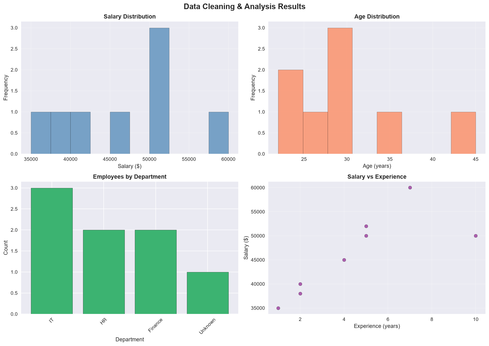
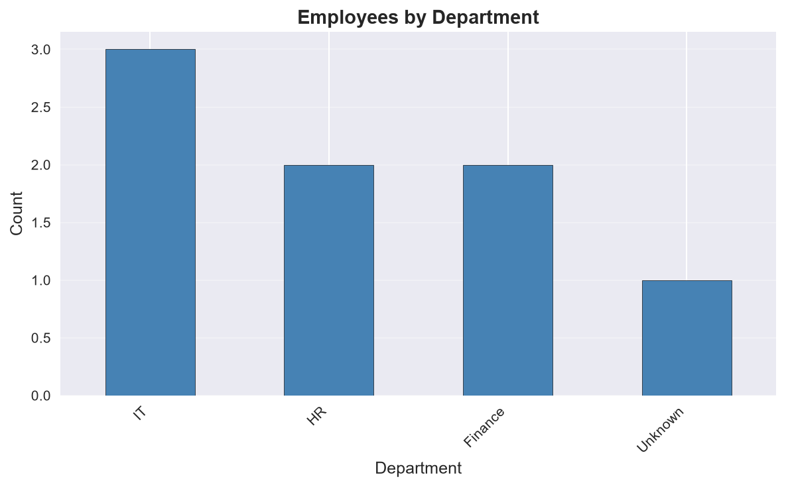
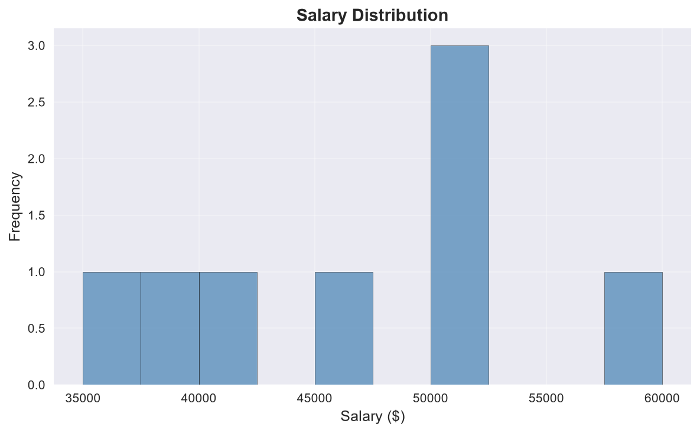

# Data Cleaning & Visualization Project

A reproducible Python data cleaning and exploratory analysis pipeline that demonstrates programmatic data validation, missing value imputation, duplicate removal, IQR-based statistical outlier filtering, and visual reporting with audit trails.

---

## Overview

Real-world datasets frequently contain missing attributes, duplicate records, data-entry errors, and statistical outliers. This project implements an automated, deterministic cleaning pipeline using `pandas`, `numpy`, `matplotlib`, and `seaborn`.

The pipeline ingests raw employee records, applies systematic data quality rules, writes out cleaned data alongside an audit trail summary, and generates exploratory visualization charts.

---

## Features

- **Automated Validation**: Verifies file existence, required column presence (`Age`, `Salary`, `Department`, `Experience`), and non-empty dataset status.
- **Missing Value Handling**:
  - Imputes numerical features (`Age`, `Salary`) with their column medians.
  - Imputes missing categorical values (`Department`) with `'Unknown'`.
- **Deduplication**: Detects and purges exact duplicate rows across all fields.
- **Statistical Outlier Detection (IQR)**:
  - Calculates first quartile ($Q_1$), third quartile ($Q_3$), and Interquartile Range ($IQR = Q_3 - Q_1$).
  - Filters values outside the fence $[Q_1 - 1.5 \times IQR, Q_3 + 1.5 \times IQR]$ on numerical columns (`Age`, `Salary`).
- **Comprehensive Audit Trail**: Produces `cleaning_summary.csv` tracking row counts and reasons at every transformation stage.
- **Exploratory Visualizations**: Generates high-resolution PNG charts:
  - Multi-panel summary dashboard (`analysis_overview.png`)
  - Department distribution bar chart (`department_count.png`)
  - Cleaned salary distribution histogram (`salary_distribution.png`)
- **Cross-Platform Compatibility**: Resolves paths using Python's `pathlib.Path` relative to script execution.

---

## Tech Stack

| Technology | Role |
| :--- | :--- |
| **Python 3.10+** (Tested on 3.12) | Core programming language |
| **pandas** (`>=2.0.0`) | Data ingestion, cleaning, transformation, and tabular audit summaries |
| **numpy** (`>=1.24.0`) | Numerical operations and array indexing |
| **matplotlib** (`>=3.7.0`) | Figure canvas creation, plot rendering, and export to PNG |
| **seaborn** (`>=0.12.0`) | Visual styling (`seaborn-v0_8`) |

---

## Prerequisites

- **Python**: Version 3.10 or higher.
- **Package Manager**: `pip` (standard Python package installer).

---

## Installation

1. **Clone the repository:**
   ```bash
   git clone https://github.com/nfsprogramming/Data-Cleaning-Visualization-Project.git
   cd Data-Cleaning-Visualization-Project
   ```

2. **Create and activate a virtual environment:**

   On **Windows (PowerShell)**:
   ```powershell
   python -m venv .venv
   .\.venv\Scripts\Activate.ps1
   ```

   On **macOS / Linux**:
   ```bash
   python3 -m venv .venv
   source .venv/bin/activate
   ```

3. **Install required dependencies:**
   ```bash
   pip install -r requirements.txt
   ```

---

## Usage

Run the primary pipeline script:

```bash
python main.py
```

The script will log each stage of the pipeline to the terminal and write outputs to the `outputs/` folder.

---

## Pipeline Workflow & Methodology

```
Raw Dataset (12 rows)
  │
  ├── 1. Schema Validation (Assert required columns exist)
  │
  ├── 2. Missing Value Imputation (Median for numeric, 'Unknown' for categorical)
  │      └─ Row count unaffected: 12 rows
  │
  ├── 3. Duplicate Detection & Removal (Drop exact matching rows)
  │      └─ 2 duplicate rows removed: 10 rows remaining
  │
  ├── 4. Outlier Filtering (1.5 × IQR method on Age & Salary)
  │      └─ 2 extreme outlier rows removed: 8 rows remaining
  │
  └── 5. Artifact Generation
         ├─ outputs/cleaned_dataset.csv
         ├─ outputs/cleaning_summary.csv
         └─ outputs/*.png (Visualizations)
```

### 1. Missing Value Imputation
- **Age**: Missing value imputed with median ($30.0$).
- **Salary**: Missing value imputed with median ($50,000.00$).
- **Department**: Missing entry imputed with `'Unknown'`.

### 2. Duplicate Removal
- Two duplicate records matching `30.0, 50000.0, IT, 5` are identified and removed, reducing the dataset from 12 to 10 rows.

### 3. IQR Outlier Filtering
Outliers are identified using the interquartile range formula:
- $\text{IQR} = Q_3 - Q_1$
- $\text{Lower Bound} = Q_1 - 1.5 \times \text{IQR}$
- $\text{Upper Bound} = Q_3 + 1.5 \times \text{IQR}$

Identified and filtered outliers:
- **Age**: Outlier at $120.0$ (bounds: $[1.62, 66.62]$).
- **Salary**: Outliers at $\$90,000.00$ and $\$1,000,000.00$ (bounds: $[\$16,125.00, \$83,125.00]$).
- Note: The row with $\text{Age}=120.0$ and $\text{Salary}=\$1,000,000.00$ is a single combined record (`CEO`). The second outlier removed is the $\text{Salary}=\$90,000.00$ record (`Management`). Total rows removed: 2.

---

## Audit Trail & Summary Results

### Pipeline Execution Summary (`outputs/cleaning_summary.csv`)

| Metric | Count | Reason |
| :--- | :--- | :--- |
| **Initial Rows** | 12 | Original dataset |
| **After Duplicate Removal** | 10 | Duplicate rows removed |
| **After Missing Value Handling** | 10 | Missing values filled (no rows removed) |
| **After Outlier Filtering** | 8 | Statistical outliers removed using IQR method |
| **Final Rows** | 8 | Final cleaned dataset |
| **Total Rows Removed** | 4 | Total rows removed during cleaning (33.3% reduction) |
| **Duplicate Rows Removed** | 2 | Exact duplicate records |
| **Outlier Rows Removed** | 2 | Values outside 1.5 × IQR range (Age, Salary) |

### Cleaned Dataset Statistics (`outputs/cleaned_dataset.csv`)

Verified descriptive statistics across the 8 retained records:

| Statistic | Age (Years) | Salary ($) | Experience (Years) |
| :--- | :--- | :--- | :--- |
| **Count** | 8 | 8 | 8 |
| **Mean** | 29.75 | \$46,250.00 | 4.50 |
| **Std Dev** | 7.36 | \$8,328.09 | 2.98 |
| **Min** | 22.00 | \$35,000.00 | 1.00 |
| **25%** | 24.50 | \$39,500.00 | 2.00 |
| **50% (Median)** | 29.50 | \$47,500.00 | 4.50 |
| **75%** | 31.00 | \$50,500.00 | 5.50 |
| **Max** | 45.00 | \$60,000.00 | 10.00 |

**Department Distribution:**
- **IT**: 3 employees (37.5%)
- **HR**: 2 employees (25.0%)
- **Finance**: 2 employees (25.0%)
- **Unknown**: 1 employee (12.5%)

---

## Visualizations

All visual artifacts are generated automatically into the `outputs/` directory.

### 1. Multi-Metric Overview Dashboard
Four-panel figure illustrating distributions and feature relationships:
- Top-left: Cleaned Salary distribution histogram.
- Top-right: Cleaned Age distribution histogram.
- Bottom-left: Employee count by department.
- Bottom-right: Experience vs. Salary scatter plot.



### 2. Department Breakdown
Detailed bar chart of employee count per department after imputation and outlier filtering:



### 3. Salary Distribution
Histogram of cleaned employee compensation:



---

## Project Structure

```
data_cleaning_visualization_project/
├── data/
│   └── raw_dataset.csv             # Raw input dataset
├── outputs/
│   ├── analysis_overview.png       # 4-panel exploratory visualization
│   ├── cleaned_dataset.csv         # Processed and cleaned dataset
│   ├── cleaning_summary.csv        # Tabular audit trail of cleaning steps
│   ├── department_count.png        # Bar chart of employees per department
│   └── salary_distribution.png     # Histogram of cleaned salaries
├── .gitignore                      # Git exclusion rules for Python & environments
├── LICENSE                         # MIT License
├── main.py                         # Complete data cleaning & visualization pipeline
├── README.md                       # Repository documentation & results
└── requirements.txt                # Pinned package dependencies
```

---

## Validation & Testing

Run pipeline verification directly using the environment's Python interpreter:

```bash
python main.py
```

Expected behavior:
- Exits with returncode `0`.
- Outputs log timestamps for each pipeline phase.
- Validates that `outputs/cleaned_dataset.csv` contains 8 rows.
- Verifies that all 3 visualization PNG images are written without errors.

---

## Limitations

- **Sample Size**: The dataset is an educational sample containing 12 initial records.
- **IQR Assumptions**: The IQR method assumes standard distribution behavior and may be aggressive on skewed or small samples.
- **Imputation Strategy**: Unconditional median imputation was selected for simplicity; larger real-world datasets may benefit from group-wise or KNN imputation.

---

## License

This project is licensed under the [MIT License](LICENSE).
